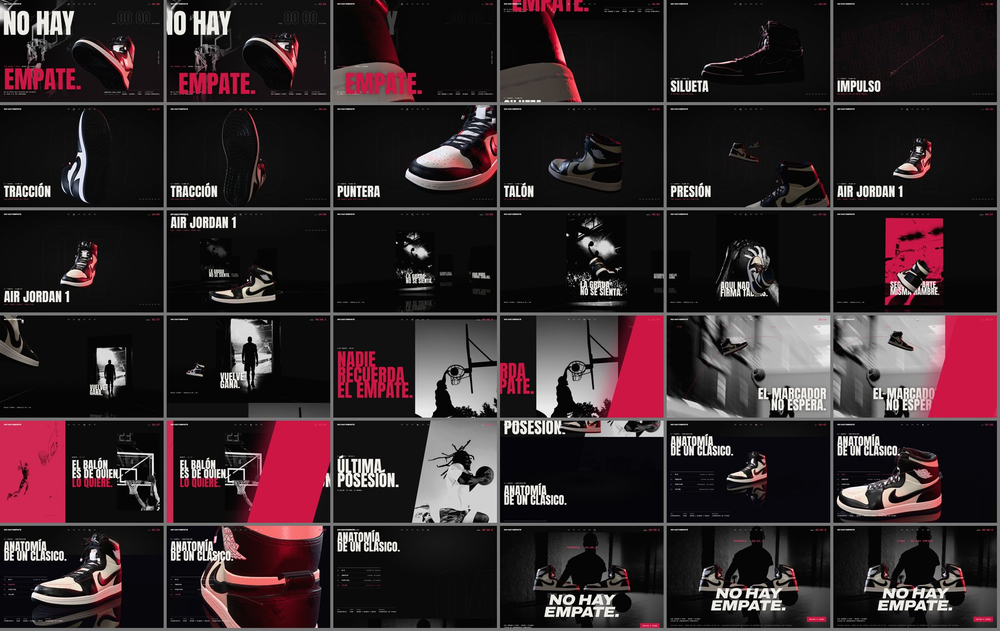

# Air Jordan 1 · «NO HAY EMPATE» · prototipo web v3

Prototipo interno de dirección de arte de Dragoon Communication Lab. Es una campaña de lanzamiento en formato web: un partido de 48 minutos contado con scroll, con la zapatilla en 3D como protagonista.

> **Repositorio privado y uso interno.** El modelo 3D contiene marcas de Nike y Jordan, y las fotografías son provisionales. No publiques este repositorio ni lo despliegues en una URL pública. Ver [CREDITOS.md](CREDITOS.md).



## Qué contiene
| Sección | Contenido |
|---|---|
| **Q1 · 1.er cuarto** | Hero de campaña: «NO HAY EMPATE.» con el titular repartido en profundidad alrededor de la zapatilla. |
| **Q2 · 2.º cuarto** | Siete planos de producto: silueta, impulso, tracción, puntera, talón, presión y plano final. |
| **HT · Medio tiempo** | La zapatilla ante el marcador del descanso y cuatro pantallas de pabellón, con cuenta atrás de 15 minutos. Tiene su propio motor 3D. |
| **Q3 · 3.er cuarto** | Recorrido horizontal por fotografías, con cortinilla roja. |
| **Q4 · 4.º cuarto** | Estudio negro con suelo espejo y recorrido de cámara por las piezas. |
| **OT · Prórroga** | El par a contraluz y el final. |

**Interacción:** al parar el scroll, la zapatilla se puede girar arrastrando, con el cursor o con el dedo. Al volver a hacer scroll recupera su pose.

## Cómo verlo en local
Hay que abrirlo desde un servidor: con doble clic (`file://`) el navegador no carga el modelo 3D ni los módulos JavaScript.

```powershell
cd no-hay-empate-v3
py -m http.server 8000
```

Después abre <http://localhost:8000/>. Si se queda en la pantalla de carga, recarga sin caché con **Ctrl+Shift+R**.

**Necesita conexión a internet:** Three.js 0.187.0, GSAP 3.13.0 y las fuentes se cargan por CDN (jsDelivr y Google Fonts).

## Estructura
```
index.html
css/main.css
js/main.js         coreografía, scroll suavizado, giro a mano, marcador
js/stage.js        motor 3D principal (Q1, Q2, Q3, Q4 y OT)
js/pista.js        sección Medio tiempo
js/world.js        motor 3D de Medio tiempo: pista, marcador LED, pantallas
assets/modelo/     air_jordan_1.glb (comprimido con meshopt; diseño original sin modificar)
assets/foto/       fotografías con el tratamiento en blanco y negro ya aplicado
assets/pantallas/  imágenes generadas para las pantallas de Medio tiempo
docs/              capturas de referencia
```

## Sobre GitHub Pages
GitHub Pages publica el sitio en una URL **pública**, aunque el repositorio sea privado (salvo con GitHub Enterprise y acceso restringido). Por las marcas y las fotos provisionales, **no lo actives** sin aprobación.

## Estado
- **Probado:** Chromium y Chrome 157 en escritorio (1440×900) y en emulación móvil (390×844), sin errores de consola. Responde bien en pantallas de alta densidad.
- **No probado:** teléfonos reales, Safari/iOS y Firefox.
- **Pendiente:**
  - textos de trabajo, fecha de lanzamiento, referencia y material;
  - fotografía definitiva;
  - en algún encuadre de Medio tiempo, la zapatilla tapa parte del titular de la pantalla.
